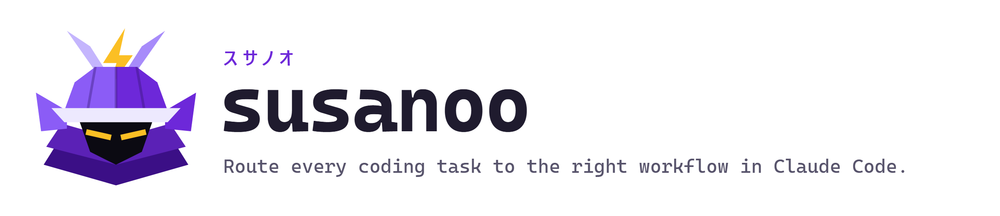
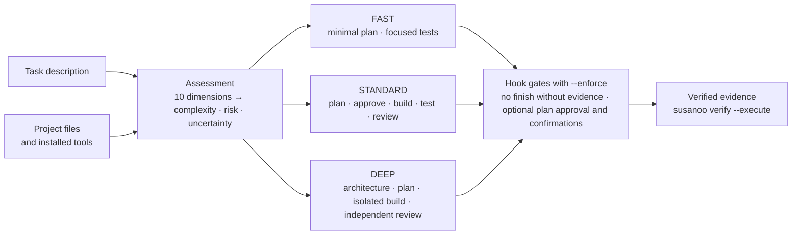

<p align="center">
  <picture>
    <source media="(prefers-color-scheme: dark)" srcset="docs/assets/banner-dark.png">
    
  </picture>
</p>

<p align="center">
  <a href="https://github.com/Breadstick-Crumbs/susanoo/actions/workflows/ci.yml"></a>
  <a href="https://github.com/Breadstick-Crumbs/susanoo/releases"></a>
  
  
  <a href="LICENSE"></a>
</p>

<p align="center">
  <a href="#quick-start">Quick start</a> ·
  <a href="#how-it-works">How it works</a> ·
  <a href="#faq">FAQ</a> ·
  <a href="docs/enforcement.md">Enforcement</a> ·
  <a href="docs/roadmap.md">Roadmap</a>
</p>

**Susanoo is an open-source workflow layer for [Claude Code](https://code.claude.com/docs).** It reads a coding task, rates how complex and how risky it is, and routes it to one of three workflows: **FAST** for trivial fixes, **STANDARD** for typical features, and **DEEP** for work that can hurt you, such as authentication, payments, or data migrations. With enforcement on, Claude Code cannot finish without verified test evidence. It is hands-off by default; set `hands_off = false` and Claude Code also cannot edit files before you approve the plan or approve its own plan.

<p align="center">
  
  <br><sub>Real <code>susanoo route</code> results, condensed. Regenerate with <code>python scripts/make_demo_svg.py</code>.</sub>
</p>

*Named after Susanoo, the storm god of Japanese myth who slew the eight-headed serpent Orochi.*

## Why

AI coding agents tend to apply the same process to everything. That wastes time on trivial changes and under-protects risky ones. A one-line change to password hashing is small but dangerous; a new dashboard page is larger but low-risk. Treating them the same is a mistake in both directions.

Susanoo keeps **complexity and risk as separate dimensions**, so a small change with security implications is never treated as routine. It checks which tools are **actually installed** instead of assuming they exist, and it treats verification as **evidence that a command ran and passed**, not as a completion message.

| | Claude Code alone | Claude Code with Susanoo |
|---|---|---|
| Process | The same for a typo and a billing change | Sized to the task: FAST, STANDARD, or DEEP, with the reasons stated |
| Risky work | Depends on what you remember to ask for | Mandatory controls: security review, data safety, sandbox credentials; irreversible-action confirmation with `hands_off = false` (otherwise Claude Code's permission settings decide) |
| Plan approval | A request in the prompt | Optional hook gate (`hands_off = false`): file edits are denied until you approve the plan |
| "Done" | Claude says the tests pass | Optional hook gate: the turn cannot end until required checks have passing evidence |
| Tools | Assumed | Discovered read-only; gaps are named, and nothing is installed without you |

## Quick start

Requires Python 3.11+. No runtime dependencies.

```bash
git clone https://github.com/Breadstick-Crumbs/susanoo.git
cd susanoo && pip install -e .
```

Then, in the project you want to work on:

```bash
susanoo doctor           # check the environment
susanoo init --enforce   # add the /susanoo skill, subagents, and enforcement hooks (--dry-run to preview)
```

And in Claude Code:

```text
/susanoo Add a low-stock alert that emails the warehouse when a SKU drops below its reorder level
```

To make Susanoo your default workflow in **every** project, so you never have to mention it, use the global install instead:

```bash
python -m pip install --user -e .   # from the susanoo folder, so `susanoo` works everywhere
susanoo init --global              # playbook, skill, subagents, and hooks in ~/.claude
```

Coding prompts are then routed automatically, questions pass through, and Susanoo is hands-off by default: it asks nothing, and Claude Code's permission settings decide what needs confirmation (with `hands_off = false`, one plan check-in at most in normal mode, none in accept-edits, auto, or bypass mode). See [docs/claude-code.md](docs/claude-code.md#as-your-default-workflow-every-project).

With `/susanoo`, Claude runs Susanoo and presents the execution brief. For STANDARD and DEEP it shares the plan and keeps going (with `[enforcement] hands_off = false` it waits for your approval at each checkpoint), works through the workflow, runs the required verification, records evidence, and reports what ran and what did not. To force a workflow, use `/susanoo --profile fast <task>`; mandatory safety controls still apply.

`susanoo init` never overwrites files it did not create: it reports conflicts, `--force` writes a backup first, and `susanoo init --uninstall` removes only files that are still unmodified. Leave out `--enforce` for the instruction-only workflow, or add `--enforce-scope settings` to also cover resumed sessions (see [enforcement](docs/enforcement.md#how-it-is-wired)).

### On the command line

The CLI works without Claude Code and without a model:

```bash
susanoo assess "Change password hashing from SHA1 to bcrypt"      # complexity / risk / uncertainty
susanoo route  "Add pagination to the /users API endpoint"         # full execution brief
susanoo route  --json "..."                                         # machine-readable
susanoo raise  deep --reason "also changes the public API"          # make the open route stricter
susanoo inventory --verify                                          # what this environment can do
susanoo verify --execute                                            # run the ready checks for the latest route
susanoo research browser_testing                                    # options for a capability gap
susanoo outcome latest --status completed --minutes 25              # record how it went
susanoo report                                                      # records, summaries, suggestions
susanoo eval                                                        # routing behavior on the reference suite
```

## How it works



The assessment is deterministic: the same task, configuration, and environment always produce the same brief. With automatic routing, Claude also judges what the keywords miss: it routes problem reports and can raise a route, but never below the keyword result for your own message ([ADR 0006](docs/decisions/0006-model-judgment-above-a-keyword-floor.md)). Claude Code does the engineering; Susanoo decides how much process the task deserves and checks the evidence. See [docs/architecture/overview.md](docs/architecture/overview.md).

| Component | What it does |
|---|---|
| **Task Intelligence** | Scores 10 dimensions (implementation, architecture, components, uncertainty, external dependencies, security/privacy, data integrity, irreversibility, testing difficulty, parallelization) from configurable, explainable heuristics. Complexity, risk, and uncertainty are independent composites. Low-information tasks are flagged as low-confidence instead of guessed. |
| **Adaptive Router** | Chooses FAST, STANDARD, or DEEP with stated reasons. You can override the profile. Mandatory safety controls (security review, data safety, irreversible-action gate, sandbox credentials) still apply after an override, and critical-risk tasks cannot be routed below a configurable floor. |
| **Capability Intelligence** | Read-only discovery of languages, build systems, test frameworks, linters, type checkers, security tools, Claude Code skills, subagents, slash commands, MCP servers, and plugins. Every finding is classified as *verified*, *installed but unverified*, *configured but inaccessible*, *missing*, or *not required*. It never reads MCP credentials. |
| **Tool Selection** | Picks the simplest reliable tool for each needed capability. A working tool beats a better one that isn't installed. CLIs and native tools are preferred over MCP servers, which add context and standing access. |
| **Capability Research** | Identifies gaps, marks which ones block the task, and evaluates candidates from a curated registry with security notes and validation steps. A `susanoo-researcher` subagent handles manual web research. Nothing is ever installed automatically. |
| **Verification Intelligence** | Selects checks by profile and risk, runs the ready ones with `susanoo verify --execute`, and stores machine-readable evidence. Results Susanoo executed itself are kept separate from results an agent reported. |
| **Evaluation & Learning** | Local JSONL records of routes, outcomes (completion, time, interventions, tokens, cost, regressions), and evidence. Per-profile summaries. Recommendations for human review, only with enough data. A deterministic routing evaluation suite. |
| **Claude Code integration** | A `/susanoo` project skill and two subagents (`susanoo-reviewer`, `susanoo-researcher`), installed without touching your settings, `CLAUDE.md`, or MCP configuration (the one opt-in exception: `--enforce-scope settings` adds Susanoo's hook entries to `.claude/settings.local.json`). |
| **Workflow enforcement (opt-in)** | `susanoo init --enforce` adds hooks that turn the critical steps into hard checks: the turn cannot end without verification evidence. With `[enforcement] hands_off = false`, file edits also wait for your plan approval, Claude cannot approve its own plan, and irreversible commands need confirmation. By default the hooks live in the skill, so only the session that ran `/susanoo` is affected and a resumed session is not enforced; `--enforce-scope settings` puts them in `.claude/settings.local.json` instead, which also covers resumed sessions and compaction. See [docs/enforcement.md](docs/enforcement.md). |
| **Code navigation** | Size-aware choice between built-in search and code-graph tools (for example a codebase-memory MCP server or its skills and agents). In large repositories the investigation phase names the graph tool. |

## Example

From [`examples/02-moderate.md`](examples/02-moderate.md), run against the bundled [`sample-app`](examples/sample-app):

```text
$ susanoo route --path examples/sample-app "Add a low-stock alert that emails the warehouse when a SKU drops below its reorder level"

## Assessment
- Complexity:  MODERATE (0.32) - implementation_complexity=moderate
- Risk:        MODERATE (0.54) - external_dependencies=moderate
- Uncertainty: LOW (0.00)
- Confidence:  high

## Recommended mode: STANDARD
Why: complexity is moderate; risk is moderate

## Required verification
- [required] Unit tests: `pytest -q`
- [required] Linting / static analysis: `ruff check .`
- [required] Integration tests: `pytest -q`
- [recommended] Type checking: `mypy .`
- [recommended] Dependency vulnerability audit: no usable tool - gap
- [recommended] Independent code review: Claude Code subagents (performed by the agent or a person)

## Checkpoints
- Approve the implementation plan before files are changed.
```

See [`examples/`](examples/) for a simple (FAST), moderate (STANDARD), and complex (DEEP) brief in full.

## FAQ

**What is Susanoo?**
An open-source, deterministic Python CLI and Claude Code integration (a skill, two subagents, and optional hooks) that sizes the engineering workflow to each coding task. It routes a task to FAST, STANDARD, or DEEP based on its complexity and risk, applies mandatory safety controls, and records verification evidence.

**How do I stop Claude Code from editing files before I approve a plan?**
Run `susanoo init --enforce`, set `hands_off = false` under `[enforcement]` in `.susanoo/config.toml`, and start the task with `/susanoo <task>`. For STANDARD and DEEP tasks, a `PreToolUse` hook denies Edit and Write until you approve the plan, and `susanoo approve` always asks you to confirm, so Claude cannot approve its own plan. See [docs/enforcement.md](docs/enforcement.md).

**How do I make Claude Code run the tests before it says it is done?**
With enforcement on, a `Stop` hook blocks the end of the turn while required verification lacks passing evidence. Runnable checks count only when Susanoo executed them itself (`susanoo verify --execute`), and a reported failure never counts as evidence.

**Can Susanoo run automatically, without typing `/susanoo`?**
Yes. `susanoo init --global` installs a hook that classifies every prompt in every project. Clear coding tasks ("add ...", "can you fix ...") are routed and a short brief is added to Claude's context. Other prompts get a one-line note: if one needs code changes ("the checkout page is broken"), Claude routes it itself, never lower than the keyword result for your message. A prompt starting with `?` is never routed. Records go to `~/.susanoo/projects/`, so nothing is added to your repositories.

**Will it keep asking me questions?**
No. By default Susanoo asks nothing in any permission mode: Claude Code's own permission settings decide what needs confirmation. With `[enforcement] hands_off = false`, Claude Code's normal mode has one check-in for a STANDARD or DEEP task: approving the plan (plus a confirmation for irreversible commands such as deploys while that safety control is active); accept-edits, auto, dontAsk, and bypass mode still ask nothing, and saying "work autonomously" or "don't ask" in a task counts as approving its plan. In every mode, Claude still cannot finish without passing checks.

**Does Susanoo use an AI model to make decisions?**
Not for its own scores. Assessment and routing are deterministic keyword and rule heuristics configured in TOML, so the same task and configuration always produce the same result, with the reasons that produced it. Susanoo makes no model calls of its own. With automatic routing, the Claude you are already working with adds its judgment on top: it routes messages the keywords did not recognize as tasks and can raise a route that understates a task. It cannot go below the keyword result for your own message, and only you can pick a lighter workflow. Whether Claude routes a message, and how it describes it, can vary between runs.

**Will it change my Claude Code settings or `CLAUDE.md`?**
Not unless you ask it to. A project install adds only its own skill, subagents, and `.susanoo/` folder, and never overwrites a file it did not create; `--enforce-scope settings` adds only Susanoo's own hook entries to `.claude/settings.local.json`. The opt-in global install (`susanoo init --global`) writes to `~/.claude`: Susanoo's hook entries in `settings.json` (other hooks and settings are kept) and a marked workflow block in `CLAUDE.md` (your own text is never changed, and a backup is written first). `--uninstall` removes what it added.

**How accurate is the routing?**
On the bundled reference suite of 44 labeled tasks, it agrees with the maintainers' labels on 42 (95.5%) and never rates a task below its labeled minimum risk. That measures consistency with stated expectations, not whether a workflow produces better software. The heuristics are hand-tuned starting points, not validated measurements. See [docs/evaluation.md](docs/evaluation.md).

**Does it work without Claude Code?**
Yes. The CLI (`susanoo assess`, `route`, `verify`, `report`) runs anywhere with Python 3.11+. The skill, subagents, and hook gates are specific to Claude Code today.

## Configuration

Every heuristic lives in [`src/susanoo/data/defaults.toml`](src/susanoo/data/defaults.toml) and can be overridden per project in `.susanoo/config.toml`: signal patterns and effects, dimension weights, thresholds, safety controls, verification rules, and the critical-risk floor. You can add tools in `.susanoo/tools.toml` and adjust profiles in `.susanoo/profiles/<name>.toml`. See [docs/configuration.md](docs/configuration.md).

## Limitations

Susanoo is an early, alpha-stage project. Know where its edges are:

- **Heuristic assessment.** Scores come from keyword signals in the task description plus a few project facts. They are hand-tuned starting points, **not validated measurements**. Instructions to leave a part of the code base alone ("fix the footer typo without touching the payments module") are recognized only in narrow, listed phrasings that name a code location, and only when the rest of the task is a single clause with a clearly trivial edit keyword (typo, wording, rename, docstring, ...); anything else still counts, so "without breaking payments" or "without touching the payment code, add idempotency keys" is treated as payments work. A task that is only a short test request ("write tests for the invoice calculator") gets lower security and data risk; a longer subject, a second clause, prepositions such as "by", "in", or "using", and words such as production, deploy, or real keep the full risk. These are keyword rules: they reduce wrong routing in the listed phrasings, not in general.
- **Routing evaluation is not outcome evaluation.** The bundled suite measures agreement with maintainer expectations, and the heuristics and labels were developed together. No claim is made that a profile produces better software until outcome data exists. See [docs/evaluation.md](docs/evaluation.md).
- **Discovery is mostly read-only.** "Installed" means found, not exercised. `--verify` runs `--version` checks only. MCP servers are never started and remote servers are never contacted.
- **Research is local.** Candidate tools come from a curated registry. There is no autonomous internet-wide discovery. Use the `susanoo-researcher` subagent for manual research.
- **Learning is advisory.** `susanoo report` suggests changes for you to review. Nothing adjusts configuration automatically.
- **Claude Code integration is instruction-based unless enforcement is on.** Without `--enforce`, the skill guides Claude but cannot force every step. With it, evidence (and, with `hands_off = false`, plan approval and irreversible actions) is checked by hooks. Those are guardrails against drift, not a sandbox. The main gates pass single live runs on Claude Code 2.1.296. With the default skill scope, sessions resumed in a new process are not enforced and compaction recovery needs a settings snippet; `--enforce-scope settings` covers both (see [docs/enforcement.md](docs/enforcement.md#how-it-is-wired)).

## Roadmap

| Phase | Focus | Status |
|---|---|---|
| 1. Core framework | Assessment, routing, CLI, Claude Code skill, tests | Done (v0.1) |
| 2. Capability intelligence | Deeper discovery, MCP/CLI selection, integration validation | Partially done |
| 3. Adaptive execution | Task decomposition, specialist delegation, stronger verification | In progress (enforcement in v0.2 and v0.4, negation-aware routing in v0.5) |
| 4. Measurement | Benchmarks, cost analysis, workflow experiments | Infrastructure in place |
| 5. Advanced intelligence | Context optimization, simulation, model routing, learning from verified outcomes | Research |
| 6. Ecosystem | PyPI, plugin distribution, community integrations, multi-harness adapters | Planned |

Details and acceptance criteria: [docs/roadmap.md](docs/roadmap.md). Work is tracked in [issues and milestones](https://github.com/Breadstick-Crumbs/susanoo/milestones).

## Contributing

Contributions are welcome. The most useful ones right now are new tool registry entries, better signals backed by routing-suite cases, and real-world outcome reports. Start with [CONTRIBUTING.md](CONTRIBUTING.md). Report security issues as described in [SECURITY.md](SECURITY.md).

## License

[Apache-2.0](LICENSE)
